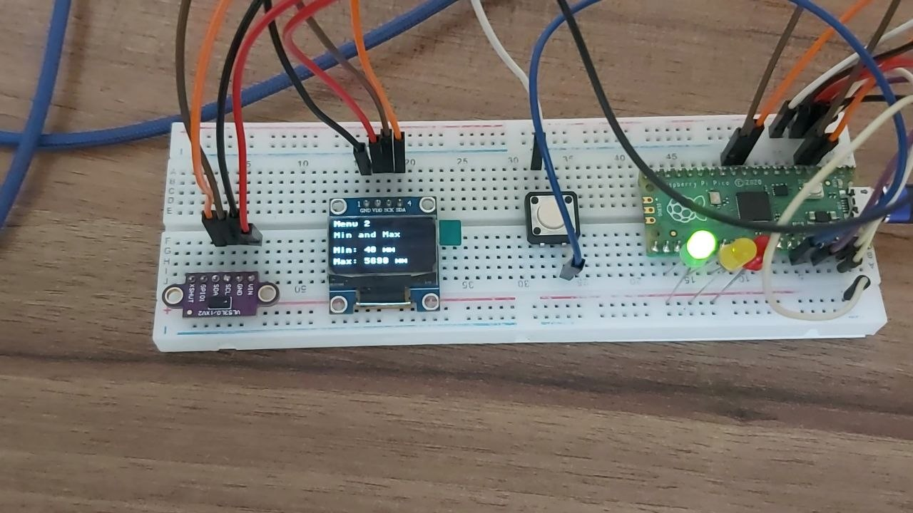

# Digital Laser Distance Meter (Raspberry Pi Pico)

A laser distance measurement system powered by the **Raspberry Pi Pico** and written in **MicroPython**. It utilizes a **VL53L0X Time-of-Flight (ToF)** sensor to measure distances in millimeters, filters readings via sample averaging, indicates proximity zones using three LEDs, and provides an interactive dual-menu interface on an **SSD1306 OLED** display.

## Features
- **Filtered Distance Measurement:** Takes 10 consecutive readings per cycle, applies a `50 mm` calibration offset (clamping negative values to `0`), and computes the average distance in millimeters (`mm`).
- **Visual Proximity Alerts:**
  - **`> 200 mm`:** Green LED ON — Status: `SAFE`
  - **`101 mm` to `200 mm`:** Orange LED ON — Status: `WARNING`
  - **`<= 100 mm`:** Red LED ON — Status: `DANGER!`
- **Dual-Screen OLED Menu (Button-Toggled):**
  - **Menu 1 (Live Distance):** Displays real-time distance (`mm`) alongside the safety status label.
  - **Menu 2 (Min and Max):** Tracks and displays the minimum (`Min`) and maximum (`Max`) recorded distances since startup.
- **Safe Shutdown & Error Handling:** Catches sensor exceptions or keyboard interrupts (`Ctrl+C`), displays the status on the OLED, stops the VL53L0X sensor, and turns off all LEDs safely.

## Hardware & Pinout

| Component / Signal | Pico GPIO Pin | Notes |
| :--- | :--- | :--- |
| **VL53L0X Sensor (I2C1)** | `GP2 (SDA)`, `GP3 (SCL)` | Dedicated I2C bus `1` |
| **OLED Display 128x64 (I2C0)** | `GP8 (SDA)`, `GP9 (SCL)` | Dedicated I2C bus `0` |
| **Menu Toggle Button** | `GP28` | Internal pull-up (`Pin.PULL_UP`), active `LOW` |
| **Green LED** | `GP17` | Safe distance indicator (`> 200 mm`) |
| **Orange LED** | `GP18` | Warning distance indicator (`101–200 mm`) |
| **Red LED** | `GP20` | Danger distance indicator (`<= 100 mm`) |

## Getting Started
1. Flash the latest **MicroPython** firmware onto your **Raspberry Pi Pico**.
2. Upload the required MicroPython driver libraries (`vl53l0x.py` and `ssd1306.py`) to the root directory of the Pico.
3. Assemble the circuit on a breadboard as shown in `circuit-photo.jpg`.
4. Upload `main.py` to the Pico (using Thonny or VS Code with the MicroPico extension) and run the script.